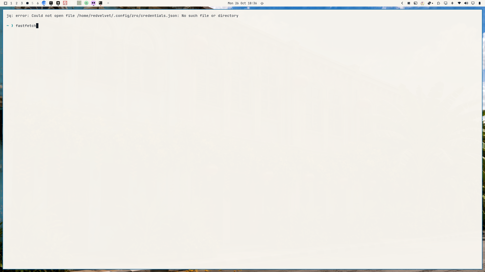

# Sino Portuguese

A light Omarchy theme drawn from Sino-Portuguese street paint: plaster walls, hot-pink and turquoise shophouses, mustard signboards, lime shutters, and azulejo blue.

The palette lives in `colors.toml`. Omarchy generates the terminal, Neovim, VS Code, Helix, and Obsidian colors from it. Six wallpapers are in `backgrounds/`.



## Installation

```bash
omarchy theme install https://github.com/Macho0x/sino-portuguese.git
```

Or from Walker (`Super+Alt+Space`): Install, Style, Theme, then paste:

```text
https://github.com/Macho0x/sino-portuguese.git
```

## Palette

| Role | Hex |
|---|---|
| background | `#F7F4EE` |
| foreground | `#1C2430` |
| accent / blue | `#0B6BA3` |
| magenta | `#C43D72` |
| yellow | `#E8B923` |
| green | `#1A9A22` |
| cyan | `#0D8A96` |
| red | `#D63A32` |
| orange | `#D45C3E` |
| selection | `#E8A99A` |
| muted | `#5C564E` |
| brown | `#9A5A3A` |
